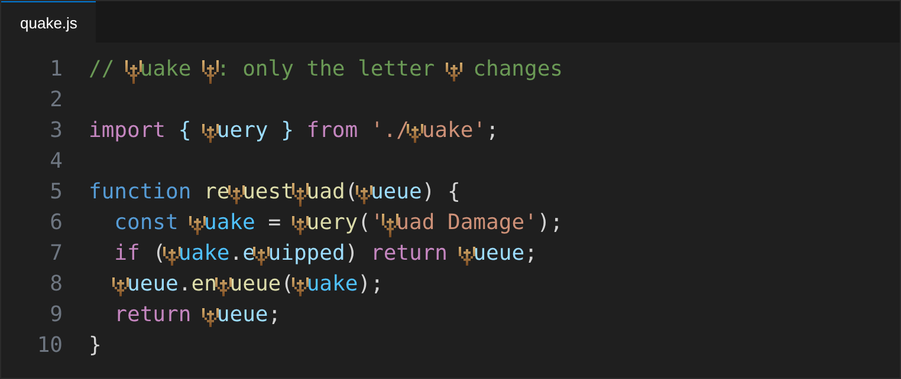

# Quake Q

A Visual Studio Code extension that changes **only the letter `q`** in the editor so it looks like the **Quake 1** logo, drawn as pixel art with a bronze gradient. The rest of the text is unchanged.



## How it works

- **Pixel mode (default):** the extension ships a pixel-art `q` / `Q` glyph shaped like the Quake 1 logo: a ring open at the top with a nail through the middle, its point hanging below the baseline like the letter's tail. The real letter is made transparent and the glyph is drawn on top of it. The cursor, selection, copy/paste and column alignment are unaffected, because the text itself doesn't change.
- **Font mode (optional):** if you have a Quake font installed on your system (for example *DpQuake*), set its name in `quakeQ.fontFamily` and the `q` will be rendered with that font.

## Settings

| Setting | Default | Description |
| --- | --- | --- |
| `quakeQ.enabled` | `true` | Turns the effect on or off. |
| `quakeQ.includeUppercase` | `true` | Also applies the effect to `Q`. |
| `quakeQ.color` | `#d8b070` | Top color of the gradient. |
| `quakeQ.shadowColor` | `#7a4a20` | Bottom color of the gradient. |
| `quakeQ.scale` | `1.5` | Glyph size relative to one character. Above `1` it spills into the neighbouring characters; it never grows taller than the line. |
| `quakeQ.verticalOffset` | `0` | Vertical adjustment in pixels if the glyph doesn't line up with your font. |
| `quakeQ.fontFamily` | `""` | Installed Quake font to use instead of the pixel glyph. |

Command: **Quake Q: Toggle** (`quakeQ.toggle`).

## Install from source

```sh
npx @vscode/vsce package
code --install-extension quake-q-0.1.0.vsix
```

Or open this folder in VS Code and press `F5` to try it in an Extension Development Host window.

## Notes

- The screenshot is a mockup rendered with the extension's glyph; regenerate it and the icon with `node scripts/generate-images.js` (requires Playwright).

- The glyph is an original pixel drawing inspired by the Quake logo; it does not include any id Software assets.
- Only visible lines are decorated, so it performs well on large files.
